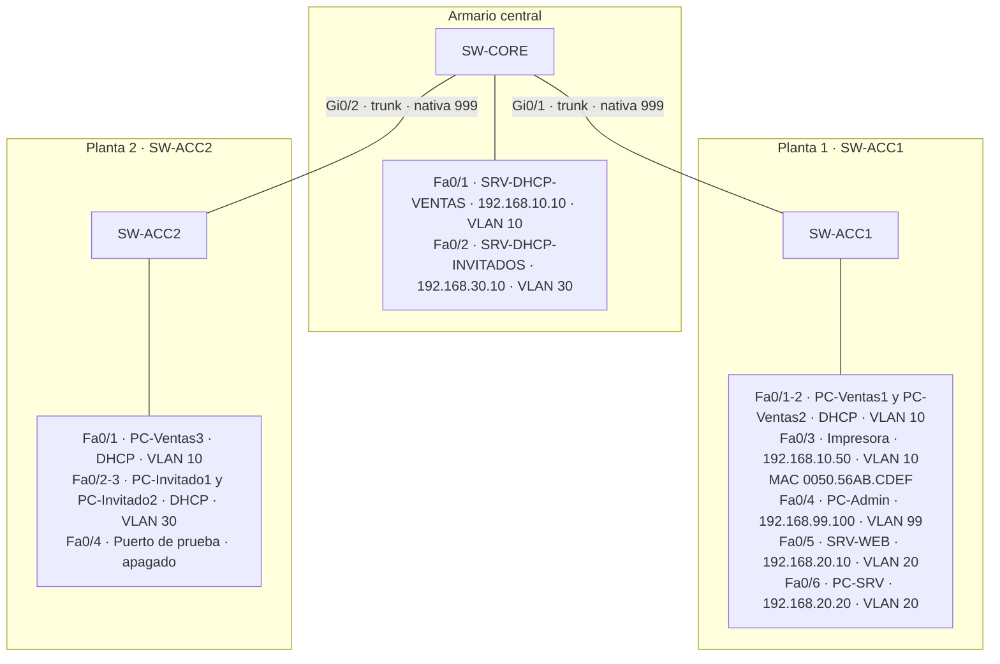
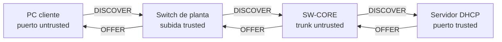

# Laboratorio de seguridad en switches: Configuración de sede.

**Módulo:** Planificación y Administración de Redes y Equipos  
**Apuntes:** [Seguridad en Switches Cisco](https://raul-profesor.github.io/PARE/SecSwitches/)  
**Simulador:** Cisco Packet Tracer 9.0.1.0858  

!!! warning "Alcance de la práctica"
    Aquí **no hay router**. Cada VLAN es una isla de capa 2. Dos equipos solo se hablan si están en la misma VLAN y esa VLAN atraviesa los trunks. Un ping entre VLANs distintas **debe fallar**: no es un error, es la política de la empresa.

## 1. Objetivos

1. Segmentar la sede en VLANs de datos, servidores, invitados, gestión, nativa y blackhole.
2. Configurar trunks 802.1Q manuales, con VLAN nativa dedicada y lista de VLANs permitidas.
3. Cerrar el acceso físico con Port Security y dejar los puertos libres en una VLAN sumidero.
4. Acelerar los puertos de usuario con PortFast y protegerlos con BPDU Guard, sin tocar los trunks.
5. Impedir servidores DHCP falsos con DHCP Snooping y comprobarlo con un equipo rogue.
6. Activar Dynamic ARP Inspection sobre las VLANs que usan DHCP.
7. Dejar la gestión de los switches en una VLAN propia, accesible por SSH.

## 2. Contexto

NorteSoft tiene la sede de Elche en una nave del polígono de Torrellano: planta 1 (ventas, administración y la sala de servidores) y planta 2 (más puestos de ventas y la zona de invitados, donde se sientan comerciales de paso y personal de una contrata).

Hasta la semana pasada todo colgaba de la VLAN 1. El jueves un instalador de la contrata enchufó en la planta 2 el router de casa «para tener Wi-Fi». El router empezó a contestar DHCP. Varios PCs de ventas renovaron la dirección, se quedaron con un gateway que no existe y perdieron la impresora del departamento. Media hora después alguien cruzó un cable entre dos rosetas y el bucle tiró la nave entera durante el tiempo que Spanning Tree tardó en enterarse.

Laura Méndez, responsable de sistemas, ha parado cualquier proyecto de salida a Internet. La consigna de esta fase es esta:

!!! quote "Cita"
    Primero se segmenta y se cierra la red. Los departamentos no tienen que verse entre sí. El enrutamiento, cuando toque, irá en otra práctica. Hoy solo hay switches.

Te toca dejar la sede como ella la ha descrito. Los comandos están en los apuntes; aquí está el plano de cómo debe quedar.

## 3. Cómo debe quedar la red

Cuando termines, la nave se comporta así.

1. **Ventas** (VLAN 10) es un único dominio de broadcast repartido entre las dos plantas. Un PC de la planta 1 habla con un PC de la planta 2 y con la impresora. No habla con invitados ni con servidores. Las direcciones de los PCs salen del servidor DHCP de ventas. La impresora no usa DHCP: tiene IP y MAC fijas, y el puerto solo acepta esa MAC.

2. **Servidores** (VLAN 20) no sale de la planta 1. Dentro están el servidor web y el PC del técnico. IPs estáticas. No hay DHCP en esa VLAN y, por eso, tampoco se inspecciona ARP ahí: Dynamic ARP Inspection no tendría contra qué comprobar.

3. **Invitados** (VLAN 30) solo vive en la planta 2 más el servidor DHCP que está en el armario central. Un invitado obtiene IP del servidor legítimo y puede hablar con ese servidor. No ve ventas ni servidores.

4. **Gestión** (VLAN 99) es el camino de Laura para entrar por SSH a los tres switches. El PC de administración está en la planta 1. No hay más equipos en esa VLAN.

5. **Nativa** (VLAN 999) no tiene usuarios. Es la VLAN sin etiquetar de todos los trunks, la misma en los dos extremos. Si alguien intenta un salto de VLAN apoyándose en la nativa, cae en una VLAN vacía.

6. **Blackhole** (VLAN 666) es el sumidero de los puertos que no se usan. Están en modo acceso, en esa VLAN, y apagados.

!!! note "Política de seguridad"
    - Los trunks van a mano (`mode trunk` y `nonegotiate`). No se negocia con DTP. Por un trunk solo pasan las VLANs 10, 20, 30 y 99.
    - El switch central es la raíz de Spanning Tree. Los enlaces de subida de las plantas llevan Root Guard, por si alguien enchufa un switch y pretende ser raíz. En los puestos de usuario el puerto pasa a forwarding al momento (PortFast) y, si recibe una BPDU, se apaga (BPDU Guard). PortFast no se pone en un trunk.
    - DHCP Snooping vigila las VLANs 10 y 30. Solo son de confianza el puerto donde está el servidor DHCP legítimo y el enlace de subida de cada planta (por ahí bajan las ofertas). El resto es untrusted.
    - DAI vigila las mismas VLANs, pero solo en los switches de planta, que es donde están los puestos. El enlace de subida se marca trusted para ARP. La impresora es la excepción: IP fija, no sale en la tabla de bindings, así que su puerto se confía **solo para ARP**. Sigue siendo untrusted para DHCP. Un puerto trusted de ARP no queda autorizado a repartir direcciones.
    - IP Source Guard cierra el círculo en un equipo real (filtra la IP de origen contra la tabla de DHCP Snooping). En el 2960 de Packet Tracer el comando casi nunca existe. El apartado es opcional: se prueba, se anota lo que responda el IOS y se deja por escrito la configuración que iría en un Catalyst de verdad.

!!! warning "Option 82 en Packet Tracer"
    Hay que **desactivar la Option 82**: el servidor del simulador descarta las peticiones que la llevan, y los PCs se quedan sin IP aunque todo lo demás esté bien. En un switch real se dejaría activa, como dicen los apuntes.

## 4. Topología

Tres switches **2960-24TT**, dos servidores DHCP, un servidor web y los PCs. Cable **Copper Straight-Through** en todos los enlaces.



Por dónde tiene que poder pasar una oferta DHCP legítima:



!!! danger "Comprueba los puertos trusted"
    Si la subida de la planta no es trusted, la oferta muere ahí. Si el trunk del core se marca trusted, una oferta falsa nacida en la otra planta puede colarse hacia abajo.

---

## 5. Cableado

| Origen | Puerto | Destino | Puerto |
| --- | --- | --- | --- |
| SW-CORE | Gi0/1 | SW-ACC1 | Gi0/1 |
| SW-CORE | Gi0/2 | SW-ACC2 | Gi0/1 |
| SW-CORE | Fa0/1 | SRV-DHCP-VENTAS | Fa0 |
| SW-CORE | Fa0/2 | SRV-DHCP-INVITADOS | Fa0 |
| SW-ACC1 | Fa0/1 | PC-Ventas1 | Fa0 |
| SW-ACC1 | Fa0/2 | PC-Ventas2 | Fa0 |
| SW-ACC1 | Fa0/3 | Impresora | Fa0 |
| SW-ACC1 | Fa0/4 | PC-Admin | Fa0 |
| SW-ACC1 | Fa0/5 | SRV-WEB | Fa0 |
| SW-ACC1 | Fa0/6 | PC-SRV | Fa0 |
| SW-ACC2 | Fa0/1 | PC-Ventas3 | Fa0 |
| SW-ACC2 | Fa0/2 | PC-Invitado1 | Fa0 |
| SW-ACC2 | Fa0/3 | PC-Invitado2 | Fa0 |
| SW-ACC2 | Fa0/4 | (vacío hasta la prueba rogue) | |

El resto de puertos no se cablean.

---

## 6. Direccionamiento

| VLAN | Nombre | Red | Quién da las IP |
| --- | --- | --- | --- |
| 10 | VENTAS | 192.168.10.0/24 | DHCP, servidor 192.168.10.10, pool .100–.200 |
| 20 | SERVIDORES | 192.168.20.0/24 | Estáticas |
| 30 | INVITADOS | 192.168.30.0/24 | DHCP, servidor 192.168.30.10, pool .100–.150 |
| 99 | GESTION | 192.168.99.0/24 | Estáticas |
| 666 | BLACKHOLE | ninguna | Puertos apagados |
| 999 | NATIVA | ninguna | Solo la nativa de los trunks |

| Equipo | IP | Máscara | Dónde |
| --- | --- | --- | --- |
| SRV-DHCP-VENTAS | 192.168.10.10 | /24 | SW-CORE Fa0/1 |
| Impresora | 192.168.10.50 | /24 | SW-ACC1 Fa0/3 |
| SRV-WEB | 192.168.20.10 | /24 | SW-ACC1 Fa0/5 |
| PC-SRV | 192.168.20.20 | /24 | SW-ACC1 Fa0/6 |
| SRV-DHCP-INVITADOS | 192.168.30.10 | /24 | SW-CORE Fa0/2 |
| PC-Admin | 192.168.99.100 | /24 | SW-ACC1 Fa0/4 |
| SW-CORE (SVI) | 192.168.99.2 | /24 | VLAN 99 |
| SW-ACC1 (SVI) | 192.168.99.11 | /24 | VLAN 99 |
| SW-ACC2 (SVI) | 192.168.99.12 | /24 | VLAN 99 |

!!! tip "Configuración DHCP en Packet Tracer"
    En los pools DHCP de Packet Tracer el campo *Default Gateway* es obligatorio. Pon la IP del propio servidor (192.168.10.10 o 192.168.30.10). No hay nadie enrutando; ese valor no se usa para salir de la VLAN.

!!! warning "No configures IPs estáticas en los clientes DHCP"
    Los PCs de ventas e invitados quedan en **DHCP**. No les pongas IP a mano: si lo haces, no se crea el binding y DAI tirará su ARP.

---

## 7. Política de puertos

Contraseñas de laboratorio (no valen fuera de clase): enable `class`, consola `class`, SSH usuario `admin` / `class123`. Dominio `nortesof.local`.

### Trunks (los dos extremos)

| Parámetro | Valor |
| --- | --- |
| Modo | `trunk` y `nonegotiate` |
| Encapsulación | 802.1Q |
| VLAN nativa | 999 |
| VLANs permitidas | 10, 20, 30, 99 |
| DHCP Snooping en el core | untrusted |
| DHCP Snooping en la subida de planta | trusted |
| DAI en la subida de planta | trusted |
| STP en la subida de planta | Root Guard. Sin PortFast |
| STP en el core | raíz primaria de las VLANs 10, 20, 30 y 99 |

### Puestos

| Puerto | Equipo | VLAN | Port Security | Violación | STP | DHCP Snooping | DAI |
| --- | --- | --- | --- | --- | --- | --- | --- |
| ACC1 Fa0/1–2 | PCs de ventas | 10 | máximo 2, sticky | restrict | PortFast + BPDU Guard | untrusted, rate 10 | rate 15 |
| ACC1 Fa0/3 | Impresora | 10 | máximo 1, MAC `0050.56AB.CDEF` | shutdown | PortFast + BPDU Guard | untrusted, rate 5 | **trust** |
| ACC1 Fa0/4 | PC-Admin | 99 | máximo 2, sticky | shutdown | PortFast + BPDU Guard | no aplica | no aplica |
| ACC1 Fa0/5 | SRV-WEB | 20 | máximo 1, sticky | shutdown | PortFast + BPDU Guard | no aplica | no aplica |
| ACC1 Fa0/6 | PC-SRV | 20 | máximo 2, sticky | restrict | PortFast + BPDU Guard | no aplica | no aplica |
| ACC2 Fa0/1 | PC-Ventas3 | 10 | máximo 2, sticky | restrict | PortFast + BPDU Guard | untrusted, rate 10 | rate 15 |
| ACC2 Fa0/2–3 | Invitados | 30 | máximo 2, sticky | restrict | PortFast + BPDU Guard | untrusted, rate 10 | rate 15 |
| ACC2 Fa0/4 | Prueba | 30 | máximo 2, sticky | shutdown | PortFast + BPDU Guard | untrusted, rate 10 | rate 15, y **shutdown** |
| CORE Fa0/1 | DHCP ventas | 10 | máximo 1, sticky | shutdown | PortFast + BPDU Guard | **trust** | no aplica |
| CORE Fa0/2 | DHCP invitados | 30 | máximo 1, sticky | shutdown | PortFast + BPDU Guard | **trust** | no aplica |

Puertos sin cable: modo acceso, VLAN 666, `shutdown`.

Recuperación de err-disable por port-security y por BPDU Guard, intervalo 300 segundos. Aun así, antes de esperar a la recuperación hay que quitar la causa y hacer `shutdown` / `no shutdown`.

---

## 8. Antes de configurar

1. Nombra los equipos como en el plano (Config > Display Name y, en los switches, `hostname`).
2. En la impresora, **antes de que el puerto aprenda nada**, entra en Config > FastEthernet y fija la MAC `0050.56AB.CDEF`. Si el puerto ya aprendió otra, quita el cable, borra la sticky y vuelve a conectar.
3. Crea las VLANs en **cada** switch. Con el dominio VTP vacío Packet Tracer no las copia solo.
4. Ten en cuenta estas diferencias de Packet Tracer:

    !!! warning "Limitaciones del simulador"
        - Ejecuta `no ip dhcp snooping information option` en los tres switches. Si no, el Server-PT no contesta.
        - `ip verify source` (IP Source Guard) probablemente responda *Invalid input*. No bloquea el resto de la práctica.
        - `crypto key generate rsa` a veces pide el módulo en un prompt aparte. Si el pegado se para, escribe `1024`.
        - Si `errdisable recovery` no existe en tu versión, anótalo y recupera los puertos a mano.

---

## 9. Apartados

!!! warning "Orden de configuración"
    Trabaja en el orden de los apuntes. No actives DAI antes de tener DHCP Snooping y algún binding.

### A. Esqueleto

Monta el cableado. Hostname, contraseña de enable, contraseña de consola, banner y `service password-encryption`. Crea las seis VLANs con su nombre en los tres switches. Todavía no hace falta que todos los puertos estén en su VLAN: primero el mapa, luego el cierre.

### B. Trunks

Configura los dos enlaces como en la tabla de trunks. Comprueba **en los dos extremos**:

```
show interfaces trunk
show interfaces gigabitEthernet 0/1 switchport
```

La nativa tiene que ser 999 a ambos lados y la lista permitida, la misma. Si el trunk no aparece, el modo no coincide o falta crear la VLAN.

### C. Accesos y blackhole

Pasa cada puerto de la tabla a modo acceso y a su VLAN. Apaga el resto en la VLAN 666. `show vlan brief` debe cuadrar con el plano antes de seguir. Un puerto en una VLAN que no existe queda inactivo y no se ve el fallo hasta el ping.

### D. Port Security

Aplica la tabla.

!!! note "Requisito de Port Security"
    El puerto tiene que estar ya en modo acceso; si no, el IOS rechaza el comando. En la impresora la MAC va estática, no sticky.

```
show port-security
show port-security address
show port-security interface fastEthernet 0/3
```

### E. Spanning Tree

Raíz en el core. PortFast y BPDU Guard en puestos. Root Guard en las subidas. Nada de PortFast en Gi0/1.

```
show spanning-tree vlan 10
show spanning-tree interface fastEthernet 0/1 detail
```

En el detalle de un puesto debe leerse que PortFast y BPDU Guard están activos. La raíz de la VLAN 10 debe ser SW-CORE.

### F. Servidores DHCP y DHCP Snooping

Configura los dos Server-PT (Services > DHCP, servicio ON) con los pools del apartado 6. Luego activa snooping en los tres switches, solo VLANs 10 y 30, sin Option 82. Marca trusted únicamente los puertos de la tabla.

Cuando los PCs pidan dirección (`ipconfig /renew` si se hubieran adelantado), revisa:

```
show ip dhcp snooping
show ip dhcp snooping binding
```

Tiene que haber un binding por cada PC que haya completado el DORA, con su MAC, su IP, su VLAN y su puerto. Si la tabla está vacía y el PC sigue en 0.0.0.0, el puerto del servidor o la subida no son trusted, o la Option 82 sigue activa.

### G. Dynamic ARP Inspection

En SW-ACC1 y SW-ACC2, DAI para las VLANs 10 y 30, validación `src-mac dst-mac ip`, rate limit en los puestos y trust en la subida. En la impresora, trust de ARP y solo de ARP.

!!! warning "No inspecciones VLANs sin bindings"
    No actives DAI en la VLAN 20 ni en la 99: no hay tabla de DHCP para ellas. No hace falta DAI en el core; ahí no hay puestos que inspeccionar.

```
show ip arp inspection
show ip arp inspection statistics
```

Prueba el ping dentro de ventas. Si DAI descarta ARP de un PC que sí tiene binding, mira si el rate limit es ridículo o si la subida no está trusted.

### H. IP Source Guard (opcional)

Intenta, en un puesto de ventas:

```
interface fastEthernet 0/1
 ip verify source port-security
```

Anota el resultado. Si el comando no existe, escribe en la entrega los comandos que pondrías en un switch real y qué tabla consultan. No los dejes a medias en la configuración de Packet Tracer.

### I. Gestión

SVI de la VLAN 99 en los tres switches, con las IP del plano. Dominio, usuario local, clave RSA de 1024 bits, SSH versión 2, VTY solo por SSH.

Desde PC-Admin:

```
ssh -l admin 192.168.99.2
```

Repite con .11 y .12. Si el PC no está en la VLAN 99, o esa VLAN no va en el trunk, el SSH ni sale del switch de planta.

### J. Prueba del DHCP rogue

1. Conecta un Server-PT a SW-ACC2 Fa0/4. IP 192.168.30.254/24. DHCP ON, pool desde 192.168.30.50, gateway 192.168.30.254, DNS 1.1.1.1.
2. `no shutdown` en Fa0/4.
3. En PC-Invitado1: `ipconfig /release` y `ipconfig /renew`.
4. La IP nueva tiene que seguir siendo 192.168.30.100 o superior, con gateway 192.168.30.10. Si sale .50 o gateway .254, el puerto de prueba está trusted o el snooping no cubre la VLAN 30.
5. Apaga Fa0/4 y desconecta el servidor falso. Ese puerto no se queda operativo.

### K. Cierre

```
copy running-config startup-config
```

en los tres switches.

---

## 10. Matriz de pruebas

Rellena Sí o No. Lo esperado va entre paréntesis.

| Origen | Destino | ¿Responde? | Esperado |
| --- | --- | --- | --- |
| PC-Ventas1 | PC-Ventas2 | | Sí |
| PC-Ventas1 | PC-Ventas3 | | Sí |
| PC-Ventas1 | Impresora 192.168.10.50 | | Sí |
| PC-Ventas1 | SRV-DHCP-VENTAS 192.168.10.10 | | Sí |
| PC-Ventas1 | PC-Invitado1 | | No |
| PC-Ventas1 | SRV-WEB | | No |
| PC-SRV | SRV-WEB | | Sí |
| PC-SRV | PC-Ventas1 | | No |
| PC-Invitado1 | SRV-DHCP-INVITADOS 192.168.30.10 | | Sí |
| PC-Invitado1 | PC-Invitado2 | | Sí |
| PC-Invitado1 | PC-Ventas3 | | No |
| PC-Admin | 192.168.99.2 / .11 / .12 por SSH | | Sí |

Además, pega en la entrega la salida de:

- `show vlan brief` de un switch de planta
- `show interfaces trunk` de SW-CORE
- `show port-security` de SW-ACC1
- `show ip dhcp snooping` y `show ip dhcp snooping binding` de SW-ACC1
- `show ip arp inspection` de SW-ACC2
- `show spanning-tree vlan 10` de SW-CORE (se ve que es raíz)

---

## 11. Preguntas

1. ¿Por qué la VLAN 999 no lleva usuarios y por qué tiene que coincidir en los dos extremos del trunk?
2. ¿Qué pasaría si el trunk del core hacia la planta 2 se marcara `ip dhcp snooping trust`?
3. La impresora no pide DHCP. ¿Por qué su puerto es trusted para DAI y untrusted para DHCP Snooping? ¿Qué ataque seguiría siendo posible si también lo marcaras trusted para DHCP?
4. ¿Por qué BPDU Filter no sustituye a BPDU Guard en un puesto de usuario?
5. IP Source Guard no ha llegado a ejecutarse en el simulador. Explica, con la tabla de bindings, qué tráfico dejaría pasar y cuál tiraría en Fa0/1 de SW-ACC1.
