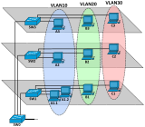
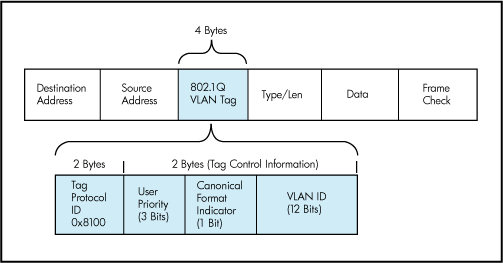
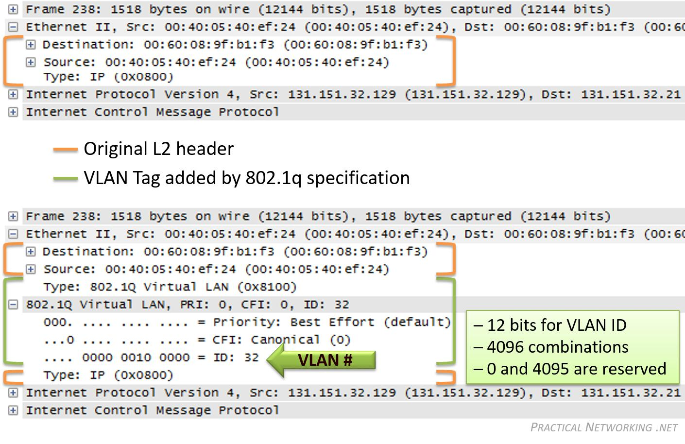
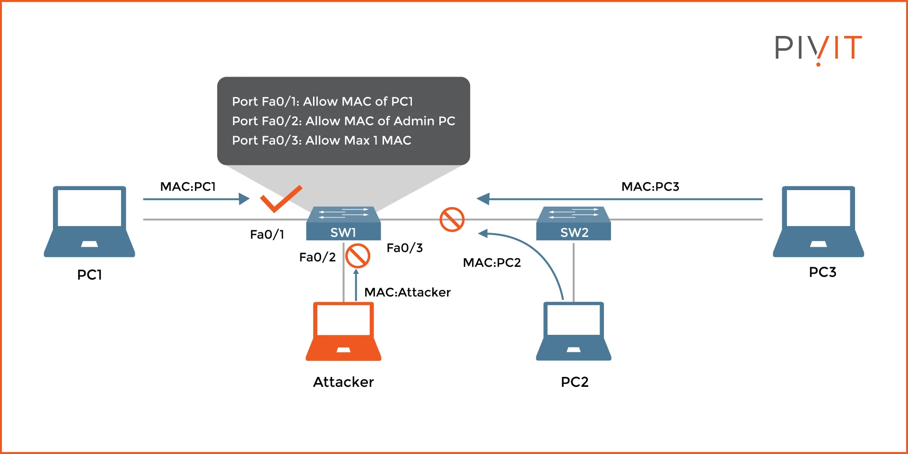
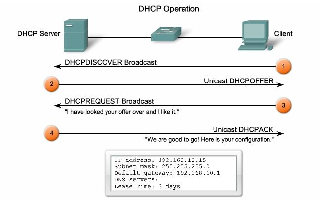
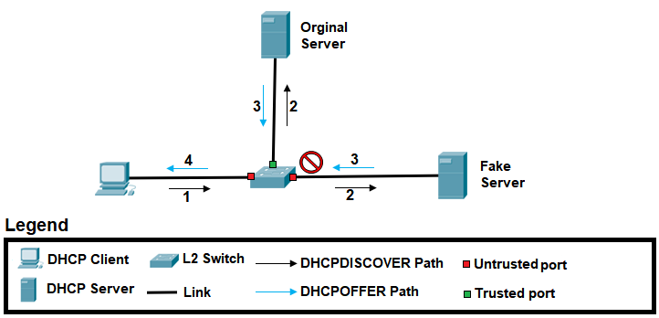
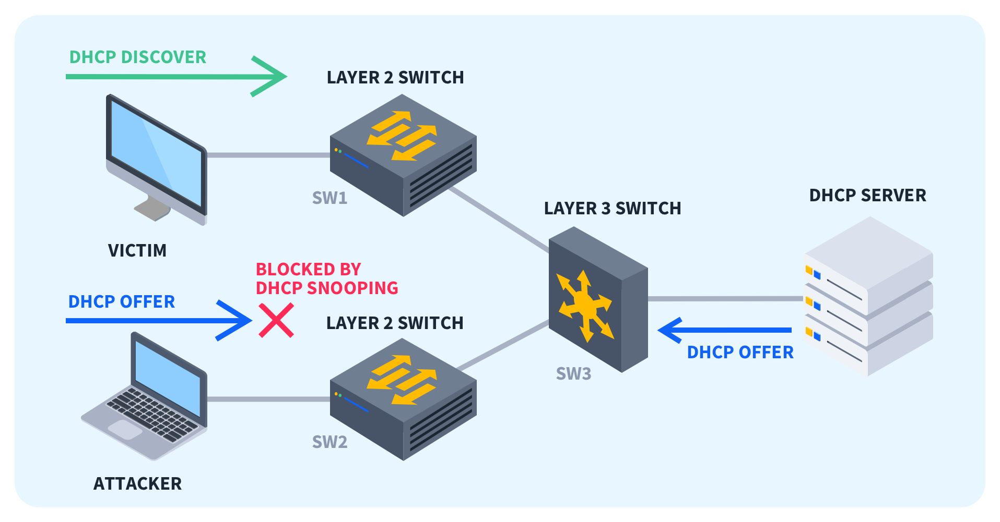

# Seguridad en Switches Cisco

## 1. VLANs y Trunks

### 1.1. ¿Qué es una VLAN?

Una **VLAN** (Virtual Local Area Network) es una **red lógica independiente** creada dentro de una infraestructura física compartida. Permite segmentar un switch en múltiples redes virtuales aisladas entre sí, como si cada departamento de un edificio tuviera su propio cableado independiente, aunque físicamente comparten el mismo equipo.

!!! question "¿Qué problema resuelve?"
    - **Dominios de broadcast excesivos**: sin VLANs, todo el tráfico broadcast llega a todos los dispositivos, consumiendo ancho de banda y recursos.
    - **Falta de seguridad**: dispositivos de diferentes áreas (contabilidad, IT, ventas) podrían comunicarse libremente.
    - **Rendimiento**: tráfico innecesario inunda todos los puertos del switch.

#### Tipos de VLANs

| Tipo | Propósito |
|------|-----------|
| **VLAN de datos** | Tráfico de usuarios finales (PCs, impresoras). |
| **VLAN de voz** | Tráfico VoIP con prioridad alta (QoS). |
| **VLAN de administración** | Gestión remota del switch (SSH, SNMP). |
| **VLAN nativa** | Tráfico sin etiquetar que viaja por un trunk. |




### 1.2. ¿Qué es un Trunk?

Un **trunk** es un enlace punto a punto entre dos dispositivos de red (switch-switch o switch-router) que transporta el tráfico de **múltiples VLANs simultáneamente** a través de un único cable físico.

!!! example "Analogía"
    Sin trunk, cada VLAN necesitaría un cable dedicado entre switches (3 VLANs = 3 cables). Con trunk, todas las VLANs comparten un solo cable: cada frame lleva una **etiqueta** (tag) que indica a qué VLAN pertenece.

### 1.3. Protocolo 802.1Q (Dot1Q)

El estándar **IEEE 802.1Q** define el mecanismo de etiquetado usado en trunks. Inserta un campo de 4 bytes en la cabecera Ethernet que incluye el **VLAN ID** (1-4094), permitiendo al receptor identificar a qué VLAN pertenece cada frame.






### 1.4. La VLAN Nativa

La **VLAN nativa** es la única VLAN cuyos frames viajan **sin etiqueta 802.1Q** a través de un trunk. Su propósito original es mantener compatibilidad con dispositivos legacy que no entienden etiquetado.

Por defecto, la VLAN nativa es la **VLAN 1**, lo cual representa un riesgo de seguridad significativo.

!!! danger "Riesgo de seguridad: VLAN Hopping"
    Un atacante puede explotar la VLAN nativa para realizar un **ataque de salto de VLAN** (VLAN Hopping): envía frames doblemente etiquetados que, al pasar por el trunk, pierden la etiqueta externa y quedan en la VLAN nativa, accediendo a segmentos de red no autorizados.

!!! tip "Mejor práctica"
    - **Nunca** usar la VLAN 1 como nativa ni para tráfico de usuario.
    - Asignar una VLAN dedicada y sin usuarios (por ejemplo, la 999) como VLAN nativa.
    - Configurar la misma VLAN nativa en **ambos extremos** del trunk.

### 1.5. Modos de Operación de Puertos (DTP)

El protocolo **DTP** (Dynamic Trunking Protocol) negocia automáticamente la formación de trunks entre switches Cisco.

| Modo | Comportamiento |
|------|----------------|
| `switchport mode trunk` | Fuerza el puerto como trunk permanente. Envía DTP. |
| `switchport mode dynamic desirable` | Intenta negociar trunk activamente. |
| `switchport mode dynamic auto` | Espera a que el otro lado inicie la negociación. |
| `switchport mode access` | Puerto de acceso: pertenece a una sola VLAN. |

!!! tip "Recomendación"
    Configurar los trunks **manualmente** (`switchport mode trunk`) en lugar de depender de la negociación automática. Es más predecible y seguro.

### 1.6. Configuración de Trunks

```cisco
! --- Configurar puerto como trunk ---
Switch(config)# interface gigabitethernet 0/1
Switch(config-if)# switchport mode trunk
Switch(config-if)# switchport trunk native vlan 999
Switch(config-if)# switchport trunk allowed vlan 10,20,30,99

! --- Configurar el otro extremo (Switch Core) ---
CoreSwitch(config)# interface gigabitethernet 0/1
CoreSwitch(config-if)# switchport mode trunk
CoreSwitch(config-if)# switchport trunk native vlan 999
CoreSwitch(config-if)# switchport trunk allowed vlan 10,20,30,99
```

### 1.7. Configuración de Puertos de Acceso

```cisco
! Puertos para el departamento de Ventas (VLAN 10)
Switch(config)# interface range fastethernet 0/1-8
Switch(config-if-range)# switchport mode access
Switch(config-if-range)# switchport access vlan 10
Switch(config-if-range)# description USUARIOS_VENTAS

! Puertos para el departamento de IT (VLAN 20)
Switch(config)# interface range fastethernet 0/9-16
Switch(config-if-range)# switchport mode access
Switch(config-if-range)# switchport access vlan 20
Switch(config-if-range)# description USUARIOS_IT
```

### 1.8. Verificación y Troubleshooting

```cisco
! Estado de todos los trunks
Switch# show interfaces trunk
Port   Mode   Encapsulation  Status     Native vlan
Gi0/1  on     802.1q         trunking   999

Port   Vlans allowed on trunk
Gi0/1  10,20,30,99

! Detalle de una interfaz específica
Switch# show interfaces gigabitethernet 0/1 switchport

! Resumen de VLANs y sus puertos
Switch# show vlan brief
```

!!! bug "Problemas frecuentes"
    | Problema | Causa | Solución |
    |----------|-------|----------|
    | El trunk no se forma | Mismatch en modo de trunk | Verificar `switchport mode trunk` en ambos lados. |
    | Pérdida de conectividad nativa | VLAN nativa diferente en cada extremo | Configurar la misma VLAN nativa en ambos lados. |
    | Una VLAN no cruza el trunk | No está en la lista `allowed` | Añadir la VLAN con `switchport trunk allowed vlan`. |

---

## 2. Port Security

### 2.1. ¿Qué es Port Security?

Port Security es un mecanismo que **restringe qué dispositivos pueden conectarse** a un puerto del switch basándose en sus direcciones **MAC**. Permite limitar cuántas y cuáles direcciones MAC pueden enviar tráfico por un puerto determinado.



!!! question "¿Qué problemas resuelve?"
    - **Conexiones no autorizadas**: impide que dispositivos desconocidos accedan a la red.
    - **Ataques MAC flooding**: previene la saturación de la tabla MAC del switch con direcciones falsas.
    - **Robo de puertos**: bloquea el uso físico de puertos para acceso no autorizado.

#### Mecanismos de aprendizaje de MAC

| Método | Descripción |
|--------|-------------|
| **Estática** | La dirección MAC se configura manualmente. |
| **Dinámica** | El switch aprende las MACs automáticamente (se pierden al reiniciar). |
| **Sticky** | El switch aprende las MACs dinámicamente y las convierte en estáticas (persisten tras reiniciar). |

### 2.2. Modos de Violación

Cuando un puerto detecta más direcciones MAC de las permitidas, o una MAC no autorizada, se produce una **violación**. El comportamiento depende del modo configurado:

| Modo | Comportamiento |
|------|----------------|
| `shutdown` | Cierra el puerto inmediatamente (err-disable). Requiere intervención manual. **El más seguro.** |
| `restrict` | Bloquea tráfico de MACs no autorizadas, permite las legítimas. Genera logs. |
| `protect` | Bloquea tráfico de MACs no autorizadas **sin generar logs**. Puede pasar desapercibido. |

### 2.3. Configuración Paso a Paso

```cisco
! Paso 1: el puerto DEBE estar en modo access
Switch(config)# interface fastethernet 0/1
Switch(config-if)# switchport mode access

! Paso 2: activar port security
Switch(config-if)# switchport port-security

! Paso 3: definir máximo de MACs permitidas
Switch(config-if)# switchport port-security maximum 2

! Paso 4: definir acción ante violación
Switch(config-if)# switchport port-security violation shutdown

! Paso 5: aprender MACs automáticamente (sticky)
Switch(config-if)# switchport port-security mac-address sticky

! Opcional: configurar MAC estática manual (ej. impresora)
Switch(config-if)# switchport port-security mac-address 0050.56AB.CDEF

! Opcional: envejecimiento de direcciones aprendidas
Switch(config-if)# switchport port-security aging time 120
Switch(config-if)# switchport port-security aging type inactivity
```

### 2.4. Ejemplo Práctico

```cisco
! --- Puerto para impresora: 1 dispositivo fijo, MAC conocida ---
Switch(config)# interface fastethernet 0/5
Switch(config-if)# switchport mode access
Switch(config-if)# switchport access vlan 10
Switch(config-if)# switchport port-security
Switch(config-if)# switchport port-security maximum 1
Switch(config-if)# switchport port-security violation shutdown
Switch(config-if)# switchport port-security mac-address 0050.56AB.CDEF
Switch(config-if)# description IMPRESORA_SALA_VENTAS

! --- Puerto para puesto de trabajo: hasta 3 dispositivos, sticky ---
Switch(config)# interface fastethernet 0/10
Switch(config-if)# switchport mode access
Switch(config-if)# switchport access vlan 20
Switch(config-if)# switchport port-security
Switch(config-if)# switchport port-security maximum 3
Switch(config-if)# switchport port-security violation restrict
Switch(config-if)# switchport port-security mac-address sticky
Switch(config-if)# switchport port-security aging time 240
Switch(config-if)# description PUESTO_TRABAJO_USUARIO

! --- Recuperación automática tras err-disable ---
Switch(config)# errdisable recovery cause psecure-violation
Switch(config)# errdisable recovery interval 300
```

### 2.5. Verificación

```cisco
Switch# show port-security
Switch# show port-security interface fastethernet 0/10
Switch# show port-security address
```

---

## 3. DHCP (Fundamentos)

Antes de entender DHCP Snooping, es necesario comprender cómo funciona DHCP.

### 3.1. ¿Qué es DHCP?

**DHCP** (Dynamic Host Configuration Protocol) es el protocolo que asigna automáticamente direcciones IP y parámetros de red (máscara, gateway, DNS) a los dispositivos de una red, evitando la configuración manual de cada equipo. Funciona como un sistema de "alquiler de direcciones" con renovación automática.

### 3.2. El Proceso DORA (4 pasos)

El proceso completo de asignación DHCP se conoce como **DORA**, por las siglas de sus cuatro mensajes:

```
 ┌──────────┐                          ┌──────────┐
 │  CLIENTE │                          │ SERVIDOR │
 │  (sin IP)│                          │   DHCP   │
 └────┬─────┘                          └────┬─────┘
      │                                     │
      │──── 1. DISCOVER (broadcast) ───────>│  "¿Hay algún servidor?"
      │                                     │
      │<─── 2. OFFER (unicast/broadcast) ── │  "Te ofrezco 192.168.1.100"
      │                                     │
      │──── 3. REQUEST (broadcast) ────────>│  "Acepto la oferta"
      │                                     │
      │<─── 4. ACK (unicast) ────────────── │  "Confirmado, usa esta IP"
      │                                     │
```

| Paso | Mensaje | Descripción |
|------|---------|-------------|
| 1 | **DISCOVER** | El cliente envía un broadcast buscando servidores DHCP. |
| 2 | **OFFER** | El servidor ofrece una IP disponible con los parámetros de red. |
| 3 | **REQUEST** | El cliente acepta la oferta (broadcast, para informar a todos los servidores). |
| 4 | **ACK** | El servidor confirma la asignación e indica el tiempo de arrendamiento (lease time). |

### 3.3. Renovación de IP

```
Tiempo de arrendamiento: 24h (ejemplo)
│
├── 50% (12h) → Cliente solicita renovación al servidor (unicast).
├── 87.5% (21h) → Si no hubo respuesta, reintenta por broadcast.
└── Expiración → La IP se libera y el cliente vuelve al paso 1 (DISCOVER).
```

{width=600 height=300}

---

## 4. DHCP Snooping

### 4.1. ¿Qué es DHCP Snooping?

**DHCP Snooping** es un mecanismo de seguridad que actúa como **guardián** del tráfico DHCP en la red. Su función es:

1. **Diferenciar** entre puertos **trusted** (donde hay servidores DHCP legítimos) y **untrusted** (donde hay clientes).
2. **Bloquear** respuestas DHCP no autorizadas (OFFER, ACK) que provengan de puertos untrusted.
3. **Construir una base de datos** (binding table) con las asignaciones IP-MAC-VLAN-Puerto que otras tecnologías de seguridad (DAI, IP Source Guard) utilizan para validar el tráfico.

!!! important "Concepto clave"
    DHCP Snooping es la **base fundamental** sobre la que se construyen DAI e IP Source Guard. Sin él, estas tecnologías no pueden funcionar.





!!! example "Analogía"
    Imagina un edificio de oficinas:

    - **Servidores DHCP legítimos** = las oficinas de administración autorizadas.
    - **Clientes DHCP** = inquilinos que necesitan llaves (IPs).
    - **Servidor DHCP rogue** = un impostor que se hace pasar por administración y entrega llaves falsas.
    - **DHCP Snooping** = el guardia de seguridad que verifica las credenciales de quien entrega las llaves.

### 4.2. Ataques que Previene

!!! danger "DHCP Starvation (Inanición)"
    Un atacante envía múltiples solicitudes DHCP con direcciones MAC falsas, agotando el pool de IPs del servidor legítimo. Los clientes legítimos no pueden obtener dirección IP.

!!! danger "DHCP Rogue (Servidor Falso)"
    Un atacante conecta un servidor DHCP no autorizado que ofrece IPs con gateway y DNS falsos, redirigiendo todo el tráfico de las víctimas. Esto permite un ataque **man-in-the-middle** completo.

!!! danger "IP Spoofing"
    Un cliente configura manualmente una IP que no le corresponde (por ejemplo, la de un servidor o la de otro departamento), eludiendo controles basados en IP.

### 4.3. Arquitectura

DHCP Snooping clasifica los puertos en dos categorías:

| Tipo de puerto | Descripción |
|----------------|-------------|
| **Trusted** | Donde se conectan servidores DHCP legítimos. Aceptan todo tipo de mensajes DHCP. |
| **Untrusted** | Donde se conectan los clientes. Solo permiten solicitudes (DISCOVER, REQUEST). **Bloquean** respuestas (OFFER, ACK) no autorizadas. |

!!! note "Binding Database"
    La tabla de bindings almacena: **MAC + IP + VLAN + Puerto + Lease time**. Es consultada por DAI e IP Source Guard para validar la legitimidad del tráfico.

### 4.4. Configuración Paso a Paso

```cisco
! Paso 1: habilitar DHCP Snooping globalmente
Switch(config)# ip dhcp snooping

! Paso 2: indicar en qué VLANs actuará
Switch(config)# ip dhcp snooping vlan 10,20,30

! Paso 3: marcar como trusted los puertos hacia servidores DHCP legítimos
Switch(config)# interface gigabitethernet 0/1
Switch(config-if)# description SERVIDOR_DHCP_LEGITIMO
Switch(config-if)# ip dhcp snooping trust

! Paso 4: los puertos de cliente son untrusted por defecto
! (no requiere comando, pero es buena práctica explicitarlo)
Switch(config)# interface range fastethernet 0/1-24
Switch(config-if-range)# no ip dhcp snooping trust
```

#### Configuración avanzada

```cisco
! Option 82: añade información del switch y puerto a las solicitudes DHCP
Switch(config)# ip dhcp snooping information option

! Rate limiting: previene ataques de inundación DHCP
Switch(config)# interface fastethernet 0/5
Switch(config-if)# ip dhcp snooping limit rate 10

! Persistencia de la base de datos de bindings
Switch(config)# ip dhcp snooping database flash:dhcp-snooping.db
Switch(config)# ip dhcp snooping database write-delay 15
```

### 4.5. Ejemplos Prácticos

#### Pequeña oficina

```cisco
Switch(config)# ip dhcp snooping
Switch(config)# ip dhcp snooping vlan 10

! Servidor DHCP en puerto Gigabit 0/1
Switch(config)# interface gigabitethernet 0/1
Switch(config-if)# ip dhcp snooping trust

! Puertos de usuario (untrusted por defecto) con rate limiting
Switch(config)# interface range fastethernet 0/1-24
Switch(config-if-range)# switchport mode access
Switch(config-if-range)# switchport access vlan 10
Switch(config-if-range)# ip dhcp snooping limit rate 5
```

#### Empresa mediana con múltiples VLANs

```cisco
Switch(config)# ip dhcp snooping
Switch(config)# ip dhcp snooping vlan 10,20,30,99
Switch(config)# ip dhcp snooping information option

! Uplink al core (trunk, trusted)
Switch(config)# interface gigabitethernet 0/1
Switch(config-if)# switchport mode trunk
Switch(config-if)# ip dhcp snooping trust

! Puertos por VLAN con rate limiting
Switch(config)# interface range fastethernet 0/1-8
Switch(config-if-range)# switchport access vlan 10
Switch(config-if-range)# ip dhcp snooping limit rate 8

Switch(config)# interface range fastethernet 0/9-16
Switch(config-if-range)# switchport access vlan 20
Switch(config-if-range)# ip dhcp snooping limit rate 8
```

#### Entorno de alta seguridad

```cisco
Switch(config)# ip dhcp snooping
Switch(config)# ip dhcp snooping vlan 1-100
Switch(config)# ip dhcp snooping information option
Switch(config)# ip dhcp snooping verify mac-address

! Base de datos persistente
Switch(config)# ip dhcp snooping database flash:dhcp-snooping.db
Switch(config)# ip dhcp snooping database timeout 10
Switch(config)# ip dhcp snooping database write-delay 10

! Puertos trusted explícitos
Switch(config)# interface range gigabitethernet 0/1-2
Switch(config-if-range)# ip dhcp snooping trust

! Rate limiting estricto en todos los puertos de cliente
Switch(config)# interface range fastethernet 0/1-48
Switch(config-if-range)# no ip dhcp snooping trust
Switch(config-if-range)# ip dhcp snooping limit rate 5
```

### 4.6. Flujo de Trabajo

1. **Inicialización**: el switch arranca con DHCP Snooping deshabilitado. El administrador lo activa con `ip dhcp snooping` y se crea una tabla de bindings vacía.
2. **Aprendizaje**: cuando un cliente legítimo completa el proceso DORA a través de un servidor trusted, el switch registra el binding (MAC + IP + VLAN + Puerto).
3. **Protección**: si un atacante conecta un servidor rogue en un puerto untrusted y envía un DHCP OFFER, el switch lo descarta y registra la violación.
4. **Mantenimiento**: el switch actualiza la tabla con renovaciones y expiraciones, y guarda periódicamente la base de datos en memoria no volátil.

### 4.7. Integración con Otras Tecnologías

DHCP Snooping es **prerrequisito** para:

```cisco
! --- Dynamic ARP Inspection (DAI) ---
Switch(config)# ip dhcp snooping vlan 10
Switch(config)# ip arp inspection vlan 10
! DAI valida respuestas ARP contra la tabla de bindings de DHCP Snooping

! --- IP Source Guard ---
Switch(config)# ip dhcp snooping vlan 10
Switch(config)# interface fastethernet 0/1
Switch(config-if)# ip verify source
! Solo permite tráfico de IPs registradas en la tabla de DHCP Snooping
```

### 4.8. Verificación y Troubleshooting

```cisco
! Estado global
Switch# show ip dhcp snooping

! Tabla de bindings (MAC + IP + VLAN + Puerto)
Switch# show ip dhcp snooping binding

! Estadísticas de paquetes descartados
Switch# show ip dhcp snooping statistics

! Estado de una interfaz específica
Switch# show ip dhcp snooping interface fastethernet 0/1

! Base de datos persistente
Switch# show ip dhcp snooping database

! Debug (solo para troubleshooting, genera mucho output)
Switch# debug ip dhcp snooping events
Switch# debug ip dhcp snooping packet
```

!!! tip "Recomendaciones"
    - Implementar en **ventana de mantenimiento**, comenzando por VLANs de prueba.
    - Tener un **plan de rollback** por si afecta a dispositivos legítimos.
    - No configurar un rate limit demasiado bajo: podría bloquear clientes legítimos.
    - Verificar compatibilidad con dispositivos IoT, que a veces tienen comportamientos DHCP inusuales.
    - Configurar **SNMP traps** para violaciones y revisar los logs periódicamente.

---

## 5. Dynamic ARP Inspection (DAI)

### 5.1. ¿Qué es DAI?

**Dynamic ARP Inspection** es un mecanismo de seguridad que **previene ataques ARP spoofing/poisoning** interceptando y validando todos los paquetes ARP en la red.

!!! question "¿Cuál es el problema del ARP?"
    El protocolo ARP no tiene autenticación: cualquier dispositivo puede enviar respuestas ARP, y los demás las aceptan sin verificar. Esto permite:

    - **ARP poisoning**: un atacante se hace pasar por el gateway, interceptando todo el tráfico.
    - **Man-in-the-middle**: el atacante se sitúa entre la víctima y el gateway sin que ninguno lo detecte.

!!! info "Cómo funciona DAI"
    1. **Intercepta** todos los paquetes ARP en puertos untrusted.
    2. **Valida** las direcciones IP y MAC contra la tabla de bindings de DHCP Snooping.
    3. **Descarta** los paquetes ARP que no coincidan.
    4. **Registra** los intentos de violación en un buffer de logs.

!!! important "Dependencia crítica"
    DAI utiliza la tabla de DHCP Snooping para validar los paquetes ARP. Si DHCP Snooping no está configurado, DAI no puede funcionar.

### 5.2. Configuración Paso a Paso

```cisco
! Paso 1: DHCP Snooping debe estar activo (prerrequisito)
Switch(config)# ip dhcp snooping
Switch(config)# ip dhcp snooping vlan 10,20

! Paso 2: habilitar DAI en las VLANs deseadas
Switch(config)# ip arp inspection vlan 10,20

! Paso 3: marcar puertos trusted (routers, servidores, uplinks)
Switch(config)# interface gigabitethernet 0/1
Switch(config-if)# ip arp inspection trust

! Paso 4: validaciones adicionales
Switch(config)# ip arp inspection validate src-mac dst-mac ip

! Paso 5: rate limiting en puertos de usuario
Switch(config)# interface range fastethernet 0/1-24
Switch(config-if-range)# ip arp inspection limit rate 15

! Paso 6: configuración de logs
Switch(config)# ip arp inspection log-buffer entries 1024
Switch(config)# ip arp inspection log-buffer logs 10 interval 60
```

#### Validaciones disponibles

| Validación | Qué comprueba |
|-----------|---------------|
| `src-mac` | La MAC origen en el ARP coincide con la MAC origen del frame Ethernet. |
| `dst-mac` | La MAC destino en el ARP coincide con la MAC destino del frame Ethernet. |
| `ip` | Las direcciones IP en el ARP son válidas (no 0.0.0.0, ni 255.255.255.255, etc.). |

### 5.3. Ejemplo Práctico Completo

```cisco
! 1. DHCP Snooping (base)
Switch(config)# ip dhcp snooping
Switch(config)# ip dhcp snooping vlan 10,20,30
Switch(config)# ip dhcp snooping information option

! 2. Puertos trusted (uplink y servidor DHCP)
Switch(config)# interface gigabitethernet 0/1
Switch(config-if)# ip dhcp snooping trust
Switch(config-if)# ip arp inspection trust

Switch(config)# interface gigabitethernet 0/2
Switch(config-if)# ip dhcp snooping trust
Switch(config-if)# ip arp inspection trust

! 3. DAI con validación completa
Switch(config)# ip arp inspection vlan 10,20,30
Switch(config)# ip arp inspection validate src-mac dst-mac ip
Switch(config)# ip arp inspection log-buffer entries 2048

! 4. Puertos de usuario (untrusted, con rate limiting)
Switch(config)# interface range fastethernet 0/1-48
Switch(config-if-range)# switchport mode access
Switch(config-if-range)# ip arp inspection limit rate 15
```

### 5.4. Verificación

```cisco
Switch# show ip arp inspection
Switch# show ip arp inspection statistics
Switch# show ip arp inspection interface fastethernet 0/10
Switch# show ip dhcp snooping binding    ! tabla que DAI consulta para validar
```

---

## 6. IP Source Guard

### 6.1. ¿Qué es IP Source Guard?

**IP Source Guard** es un mecanismo que **filtra el tráfico IP** en un puerto basándose en la tabla de bindings de DHCP Snooping. Solo permite que un dispositivo envíe tráfico desde la IP (y opcionalmente la MAC) que se le asignó legítimamente por DHCP.

!!! question "¿Qué problemas resuelve?"
    - **IP spoofing**: un usuario configura manualmente una IP que no le pertenece.
    - **Ataques DoS**: dispositivos maliciosos suplantan IPs de otros.
    - **Robo de servicios**: usar IPs de departamentos con privilegios especiales.

!!! info "Cómo funciona"
    1. **Aprende** los bindings IP-MAC de la tabla de DHCP Snooping.
    2. **Instala** filtros de tráfico en el hardware del switch (TCAM).
    3. **Permite** solo el tráfico cuya IP origen coincide con el binding.
    4. **Actualiza** dinámicamente los filtros cuando expiran o se renuevan los leases DHCP.

### 6.2. Configuración Paso a Paso

```cisco
! Prerrequisito: DHCP Snooping activo
Switch(config)# ip dhcp snooping vlan 10

! Verificación solo de IP origen
Switch(config)# interface fastethernet 0/1
Switch(config-if)# ip verify source

! Verificación de IP + MAC (requiere Port Security)
Switch(config-if)# ip verify source port-security

! Verificación completa: IP + MAC + VLAN
Switch(config-if)# ip verify source vlan dhcp-snooping port-security
```

### 6.3. Ejemplo Práctico

```cisco
! 1. DHCP Snooping
Switch(config)# ip dhcp snooping vlan 10,20
Switch(config)# ip dhcp snooping information option

Switch(config)# interface gigabitethernet 0/1
Switch(config-if)# ip dhcp snooping trust

! 2. Port Security (para verificación MAC)
Switch(config)# interface range fastethernet 0/1-24
Switch(config-if-range)# switchport mode access
Switch(config-if-range)# switchport port-security
Switch(config-if-range)# switchport port-security maximum 2
Switch(config-if-range)# switchport port-security violation restrict
Switch(config-if-range)# switchport port-security mac-address sticky

! 3. IP Source Guard con verificación IP + MAC
Switch(config)# interface range fastethernet 0/1-24
Switch(config-if-range)# ip verify source port-security

! 4. Servidor con IP estática (solo verificación IP)
Switch(config)# interface fastethernet 0/25
Switch(config-if)# switchport port-security mac-address 0050.5687.1234
Switch(config-if)# ip verify source
```

### 6.4. Verificación

```cisco
Switch# show ip verify source
Switch# show ip source binding
Switch# show ip dhcp snooping binding
Switch# show port-security address
```

---

## 7. Spanning-Tree Security (PortFast, BPDU Guard, BPDU Filter)

### 7.1. PortFast

**PortFast** es una optimización para puertos de acceso que conectan **dispositivos finales** (PCs, impresoras, servidores). Acelera el inicio del puerto saltándose los estados de *listening* y *learning* del Spanning-Tree Protocol (STP), pasando directamente a *forwarding*.

| Sin PortFast | Con PortFast |
|--------------|--------------|
| Bloqueando → Escuchando → Aprendiendo → Reenvío (~30 s) | Directamente a Reenvío (casi instantáneo) |

!!! tip "Analogía"
    Sin PortFast es como esperar a que un motor frío se caliente antes de arrancar. Con PortFast es como tener el coche ya caliente y listo para circular.

!!! danger "Advertencia crítica"
    **Nunca** activar PortFast en un puerto que conecte a otro switch, hub o router. STP no tendría tiempo de detectar y bloquear bucles de capa 2.

#### Relación con BPDU Guard

PortFast suele combinarse con **BPDU Guard**: si un usuario conecta accidentalmente un switch a un puerto con PortFast, BPDU Guard detecta el paquete BPDU y desactiva el puerto inmediatamente, evitando un bucle. Es el "seguro de seguridad" de PortFast.

#### Configuración

```cisco
! Por interfaz (recomendado)
Switch(config)# interface fastethernet 0/1
Switch(config-if)# spanning-tree portfast
Switch(config-if)# spanning-tree bpduguard enable

! De forma global (todos los puertos access con PortFast)
Switch(config)# spanning-tree portfast default
Switch(config)# spanning-tree portfast bpduguard default
```

#### Verificación

```cisco
Switch# show spanning-tree interface fastethernet 0/1 detail
! Buscar: "Portfast enabled" y "Bpdu guard enabled"
```

### 7.2. BPDU Guard y BPDU Filter

Las **BPDUs** (Bridge Protocol Data Units) son los mensajes que intercambian los switches para construir y mantener el árbol de Spanning-Tree.

#### BPDU Guard

!!! info "Propósito"
    Proteger puertos de acceso contra la recepción de BPDUs. Si un puerto con PortFast recibe una BPDU, se desactiva inmediatamente (err-disable).

```cisco
! Método 1: global (recomendado, aplica a todos los puertos con PortFast)
Switch(config)# spanning-tree portfast bpduguard default

! Método 2: por interfaz
Switch(config)# interface fastethernet 0/1
Switch(config-if)# spanning-tree portfast
Switch(config-if)# spanning-tree bpduguard enable

! Recuperación automática
Switch(config)# errdisable recovery cause bpduguard
Switch(config)# errdisable recovery interval 300
```

#### BPDU Filter

!!! info "Propósito"
    Silenciar completamente las BPDUs en un puerto: bloquea tanto el envío como la recepción.

!!! warning "Precaución"
    BPDU Filter puede **causar bucles de red** si se conecta un switch al puerto filtrado. Usar solo en casos muy específicos (por ejemplo, servidores de virtualización que generan BPDUs pero no deben participar en STP).

```cisco
! Método 1: global
Switch(config)# spanning-tree portfast bpdufilter default

! Método 2: por interfaz
Switch(config)# interface fastethernet 0/2
Switch(config-if)# spanning-tree bpdufilter enable
```

#### ¿Cuándo usar cada uno?

| Tecnología | Cuándo usarla | Riesgo |
|------------|---------------|--------|
| **BPDU Guard** | Puertos de usuario final. Si llega una BPDU, se cierra el puerto. | Bajo: solo desactiva el puerto. |
| **BPDU Filter** | Servidores o dispositivos que envían BPDUs sin participar en STP. | Alto: puede causar bucles si se conecta un switch. |

### 7.3. Verificación General de STP Security

```cisco
Switch# show spanning-tree summary
Switch# show spanning-tree interface fastethernet 0/1 detail
Switch# show errdisable recovery
```

---

## 8. Configuración Integrada Completa

A continuación se muestra la configuración completa de un **switch de acceso corporativo seguro** que integra todas las tecnologías vistas:

```cisco
! ============================================================
! INICIALIZACIÓN
! ============================================================
Switch> enable
Switch# configure terminal
Switch(config)# hostname SW-ACCESO-01

! ============================================================
! VLANs
! ============================================================
SW-ACCESO-01(config)# vlan 10
SW-ACCESO-01(config-vlan)# name USUARIOS
SW-ACCESO-01(config-vlan)# vlan 20
SW-ACCESO-01(config-vlan)# name SERVIDORES
SW-ACCESO-01(config-vlan)# vlan 99
SW-ACCESO-01(config-vlan)# name ADMIN
SW-ACCESO-01(config-vlan)# vlan 999
SW-ACCESO-01(config-vlan)# name NATIVA
SW-ACCESO-01(config-vlan)# exit

! Interfaz de administración
SW-ACCESO-01(config)# interface vlan 99
SW-ACCESO-01(config-if)# ip address 192.168.99.10 255.255.255.0
SW-ACCESO-01(config-if)# no shutdown

! ============================================================
! PUERTOS UPLINK (trusted) — hacia el core
! ============================================================
SW-ACCESO-01(config)# interface gigabitethernet 0/1
SW-ACCESO-01(config-if)# description UPLINK_TO_CORE_SWITCH
SW-ACCESO-01(config-if)# switchport mode trunk
SW-ACCESO-01(config-if)# switchport trunk native vlan 999
SW-ACCESO-01(config-if)# switchport trunk allowed vlan 10,20,99
SW-ACCESO-01(config-if)# ip dhcp snooping trust
SW-ACCESO-01(config-if)# ip arp inspection trust
SW-ACCESO-01(config-if)# spanning-tree guard root
SW-ACCESO-01(config-if)# no shutdown

! ============================================================
! PUERTOS DE USUARIO (untrusted)
! ============================================================
SW-ACCESO-01(config)# interface range fastethernet 0/1-24
SW-ACCESO-01(config-if-range)# description PUERTOS_USUARIOS
SW-ACCESO-01(config-if-range)# switchport mode access
SW-ACCESO-01(config-if-range)# switchport access vlan 10

! Port Security
SW-ACCESO-01(config-if-range)# switchport port-security
SW-ACCESO-01(config-if-range)# switchport port-security maximum 3
SW-ACCESO-01(config-if-range)# switchport port-security violation shutdown
SW-ACCESO-01(config-if-range)# switchport port-security mac-address sticky
SW-ACCESO-01(config-if-range)# switchport port-security aging time 120

! Spanning-Tree Security
SW-ACCESO-01(config-if-range)# spanning-tree portfast
SW-ACCESO-01(config-if-range)# spanning-tree bpduguard enable

! IP Source Guard
SW-ACCESO-01(config-if-range)# ip verify source port-security

! DAI rate limiting
SW-ACCESO-01(config-if-range)# ip arp inspection limit rate 15
SW-ACCESO-01(config-if-range)# no ip dhcp snooping trust
SW-ACCESO-01(config-if-range)# no shutdown

! ============================================================
! PUERTOS DE SERVIDORES
! ============================================================
SW-ACCESO-01(config)# interface range gigabitethernet 0/2-4
SW-ACCESO-01(config-if-range)# description SERVIDORES
SW-ACCESO-01(config-if-range)# switchport mode access
SW-ACCESO-01(config-if-range)# switchport access vlan 20
SW-ACCESO-01(config-if-range)# switchport port-security
SW-ACCESO-01(config-if-range)# switchport port-security maximum 1
SW-ACCESO-01(config-if-range)# switchport port-security violation shutdown
SW-ACCESO-01(config-if-range)# spanning-tree portfast
SW-ACCESO-01(config-if-range)# spanning-tree bpduguard enable
SW-ACCESO-01(config-if-range)# ip verify source
SW-ACCESO-01(config-if-range)# no shutdown

! ============================================================
! CONFIGURACIONES GLOBALES DE SEGURIDAD
! ============================================================

! DHCP Snooping
SW-ACCESO-01(config)# ip dhcp snooping
SW-ACCESO-01(config)# ip dhcp snooping vlan 10,20
SW-ACCESO-01(config)# ip dhcp snooping information option

! Dynamic ARP Inspection
SW-ACCESO-01(config)# ip arp inspection vlan 10,20
SW-ACCESO-01(config)# ip arp inspection validate src-mac dst-mac ip
SW-ACCESO-01(config)# ip arp inspection log-buffer entries 1024

! BPDU Guard global para puertos con PortFast
SW-ACCESO-01(config)# spanning-tree portfast bpduguard default

! Recuperación automática de err-disable
SW-ACCESO-01(config)# errdisable recovery cause all
SW-ACCESO-01(config)# errdisable recovery interval 600

! ============================================================
! GUARDAR
! ============================================================
SW-ACCESO-01(config)# end
SW-ACCESO-01# copy running-config startup-config
```

### Comandos de Verificación Global

```cisco
! Estado general
SW-ACCESO-01# show running-config
SW-ACCESO-01# show vlan brief
SW-ACCESO-01# show interfaces status

! Seguridad
SW-ACCESO-01# show port-security
SW-ACCESO-01# show port-security address
SW-ACCESO-01# show ip dhcp snooping
SW-ACCESO-01# show ip arp inspection
SW-ACCESO-01# show ip verify source
SW-ACCESO-01# show ip dhcp snooping binding

! Monitoreo
SW-ACCESO-01# show interface counters errors
SW-ACCESO-01# show errdisable recovery
SW-ACCESO-01# show logging

! Troubleshooting específico
SW-ACCESO-01# show mac address-table interface fastethernet 0/1
SW-ACCESO-01# show spanning-tree interface fastethernet 0/1 detail
```

---

## 9. Resumen y Mejores Prácticas

### 9.1. Recomendaciones por Tecnología

| Tecnología | Mejores prácticas |
|------------|-------------------|
| **VLANs** | Nunca usar VLAN 1 para tráfico de usuario. Usar una VLAN nativa dedicada y sin usuarios. Segmentar por función, no solo por ubicación. |
| **Trunks** | Configurar manualmente (`mode trunk`). Limitar VLANs permitidas a las estrictamente necesarias. Misma VLAN nativa en ambos extremos. |
| **Port Security** | Usar `violation shutdown` en entornos seguros. Usar `sticky` para despliegues iniciales. Configurar recuperación automática de err-disable. |
| **DHCP Snooping** | Habilitar en todas las VLANs con clientes. Marcar como trusted solo los puertos con servidores DHCP legítimos. Configurar rate limiting y Option 82. |
| **DAI** | Requiere DHCP Snooping activo. Usar validación completa (`src-mac dst-mac ip`). Rate limiting esencial para prevenir DoS. |
| **BPDU Guard** | Activar globalmente con PortFast. Configurar recuperación automática. Nunca en puertos trunk. |
| **IP Source Guard** | Requiere DHCP Snooping. Combinar con Port Security (`port-security`) para máxima seguridad. |

### 9.2. Orden Recomendado de Implementación

1. **VLANs y segmentación**: diseñar la estructura lógica de la red.
2. **Trunks seguros**: configurar trunking con VLAN nativa dedicada.
3. **Port Security**: restringir acceso físico a la red.
4. **DHCP Snooping**: establecer la base de datos de bindings.
5. **DAI**: proteger contra ataques ARP usando la tabla de bindings.
6. **BPDU Guard**: prevenir bucles por switches no autorizados.
7. **IP Source Guard**: filtrar tráfico IP no autorizado.
8. **Verificación y ajuste**: revisar logs, ajustar rate limits y pulir la configuración.
